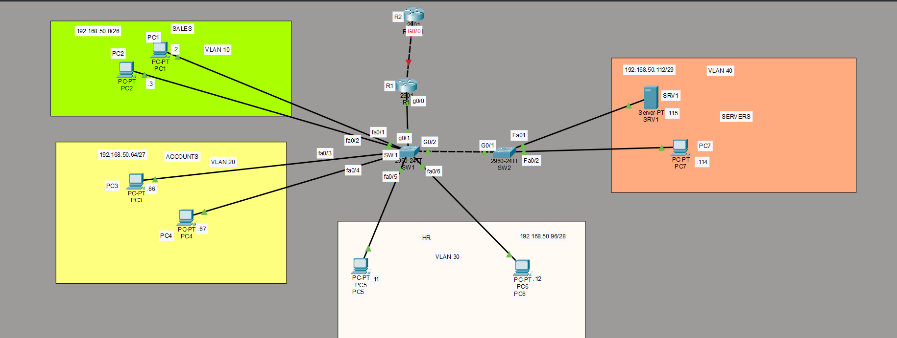

# Lab 02: VLSM Re-addressing
*Simulated scenario in Cisco Packet Tracer*

## Scenario (Ticket #002)
The Nairobi office outgrew its flat 192.168.x.x plan, which wastes addresses.
The owner wants addresses sized to each department using one block,
192.168.50.0/24, with room left for a future 30-host VLAN.

## Addressing plan
| Segment (hosts) | VLAN | Network | Usable | Broadcast | Gateway |
| Sales (50)      | 10 | 192.168.50.0/26 | .1-.62 | .63 | .1 |
| Accounts (25)   | 20 | 192.168.50.64/27 | .65-.94 | .95 | .65 |
| HR (12)         | 30 | 192.168.50.96/28 | .97-.110 | .111 | .97 |
| Servers (5)     | 40 | 192.168.50.112/29 | .113-.118 | .119 | .113 |
| Link to R2      | n/a | 192.168.50.120/30 | .121-.122 | .123 | R1 .121, R2 .122 |

**Future expansion:** 192.168.50.128/26, usable .129-.190, gateway .129.
A /27 gives only 30 usable addresses, which is one short once the gateway
takes one, so a /26 is the smallest that fits.
**Gap:** 192.168.50.124/30 (.125-.126) is unused.
**Leftover:** 192.168.50.192/26 (.193-.254).
**Tradeoff:** the Servers /29 has exactly 5 usable hosts and no growth room.

## Design notes
- Router-on-a-stick: one subinterface per VLAN on R1, plus a native VLAN
  subinterface with no IP address, because no hosts live in it.
- A second switch (SW2) carries VLAN 40 and the servers. SW1 and SW2 are
  joined by a trunk, and the native VLAN matches on both ends.
- R1 has a default route to R2. R2 has one static summary route for
  192.168.50.0/24 pointing back to R1.
- R2 simulates an upstream router. A real ISP link would need NAT for private
  addresses, which I'll cover in a later lab.

## Configuration evidence
SW1 and SW2:
![SW2 VLANs]:(
sw2 vlans.png)
![SW2 trunk]:(
sw2 g01 int tr.png)

R1:

R2:

## Connectivity tests
| # | From | To | Result |
|---|---|---|---|
| 1 | Sales | Accounts | Pass |
| 2 | Sales | HR | Pass |
| 3 | Sales | Servers | Pass |
| 4 | Sales | R2 | Pass |
| 5 | Accounts | HR | Pass |
| 6 | Accounts | Servers | Pass |
| 7 | Accounts | R2 | Pass |
| 8 | HR | Servers | Pass |
| 9 | HR | R2 | Pass |
| 10 | Servers | R2 | Pass |

Screenshots:  
 
 
 
 

## Problems and fixes
**1. Routing loop to an unused address**
- Symptom: a trace to 192.168.50.200 bounced between R1 and R2.
- Cause: R1's default route sent unknown addresses to R2, and R2's summary
  route sent the whole /24 back to R1.
- Fix: a Null0 route for 192.168.50.0/24 on R1. The more specific real subnets
  still win by longest prefix match.

Before:

After:

**2. Only VLAN 40 showed on SW2**
- Cause: I forgot to create VLANs 10, 20 and 30 on SW2.
- Found it with `show vlan brief`. Fix: created them on SW2.

**3. Native VLAN addressing**
I wondered whether the native VLAN needed an IP address. It doesn't: it
decides which VLAN's traffic crosses the trunk untagged.

## What I learned
- A subnet must start on a multiple of its block size, so I can't always use
  the next free address.
- A summary route needs a Null0 partner on the other router, or unused
  addresses loop.
- VLANs must exist on every switch the trunk carries them to.

Full notes: [notes.txt](notes(vlsm).txt)
